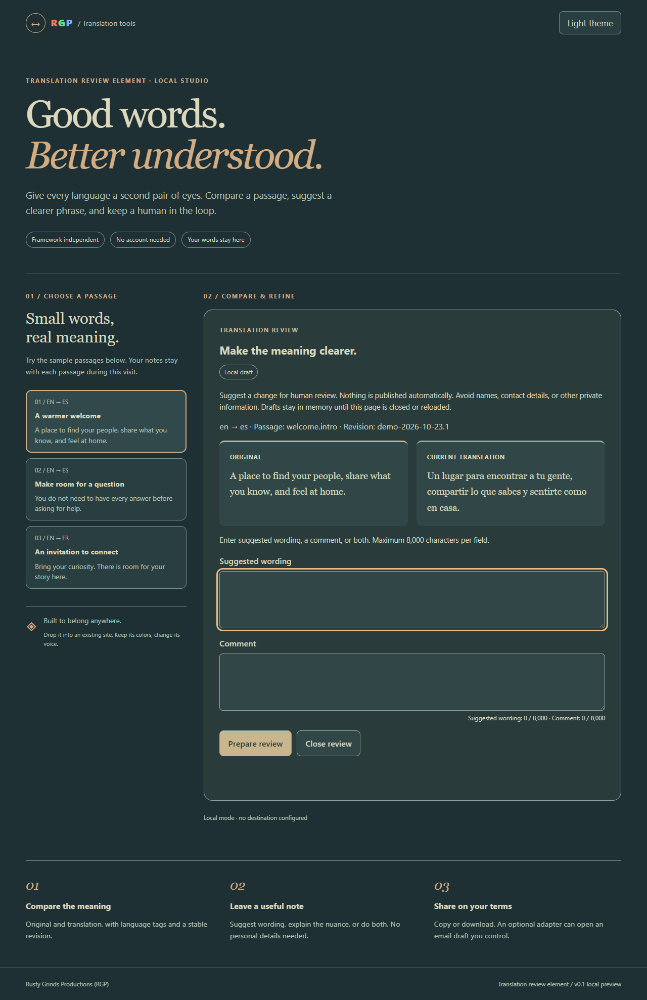

# translation-review-element

A small, framework-independent Web Component for comparing a passage and preparing a human translation review. Author: **Rusty Grinds Productions (RGP)**.

**Version 0.1.0 · MIT licensed.** Source, demo and tests are provided under the [MIT License](LICENSE). The package remains `private: true` to prevent accidental npm publication. There is currently no npm/CDN release to install.

The runtime is three native JavaScript modules with **zero dependencies**. No build step, account, AI service, telemetry, backend, persistence, or automatic email sending. Suggestions never change the source or translation.



The approved demo also includes a [distinct light theme](docs/images/demo-light.png). Both use muted colors; the small R/G/P brand accents are demo-only.

## Run locally

Download/extract the source archive or clone the source repository:

```sh
git clone https://github.com/RustyGrinds/translation-review-element.git
cd translation-review-element
```

With Node 20 or later, from the project directory:

```sh
node tools/serve.js
```

Open **http://127.0.0.1:4177/** on the same computer. The server binds only to loopback and serves only `demo/` and `src/` assets. Set `PORT` if needed. Stop with Ctrl+C; leave the process running while viewing the demo. No dependency installation is needed to run it. Serve modules over HTTP(S); opening `index.html` as a file is not supported by module security rules. All demo assets and typography are local/system resources.

## Drop into any site

Copy the entire `src/` directory into your site's static assets. Keep its three files together. Load the module once:

```html
<script type="module" src="/components/translation-review.js"></script>
<button id="review-welcome" type="button">Review this passage</button>
<translation-review
  passage-id="welcome.intro"
  source-locale="en"
  target-locale="es"
  revision="content-2026-10-23.1"
  source-text="You are welcome here."
  translated-text="Aquí eres bienvenido."
  theme="dark">
  <p>Reviewer unavailable. Save your suggested wording in a text file.</p>
</translation-review>
```

For dynamic or untrusted text, use properties, not HTML interpolation. Hosts should offer labeled buttons/a passage list for keyboard and touch selection. Native text selection alone is not a complete accessible passage picker.

```js
await customElements.whenDefined('translation-review');
const reviewer = document.querySelector('translation-review');

reviewer.passage = {
  passageId: 'welcome.intro',       // stable across translation changes
  sourceText: 'You are welcome here.',
  translatedText: 'Aquí eres bienvenido.',
  sourceLocale: 'en',              // BCP 47 language tags
  targetLocale: 'es',
  revision: 'content-2026-10-23.1', // change when reviewed content changes
  pageReference: 'https://example.org/welcome'
};

// A host passage-selection button can open the same reviewer.
const passageButton = document.querySelector('#review-welcome');
passageButton.addEventListener('click', () => {
  reviewer.open({ returnFocus: passageButton });
});
// For an initially expanded form, preserve initial page focus:
// reviewer.open({ focus: false });
```

`passage` replaces the full passage object; its getter returns frozen, normalized metadata. Attributes use the kebab-case equivalents shown above plus `page-reference`. Assign the full property in one operation for dynamic passage changes. Attributes and properties are inputs; property changes do not reflect back to attributes.

Notes are retained in memory per exact normalized passage object, including its revision and text. Close/Escape retains notes and returns focus to the host trigger. Pass the host button as `returnFocus` to `open()` because pointer activation in Safari/WebKit does not necessarily focus buttons. Without it, the currently focused control is used when available, otherwise the component's launcher. Switching back restores that passage's notes. Reloading discards all notes. `reviewer.clearDrafts()` explicitly clears every draft and the prepared output. Avoid changing metadata on each keystroke. There is no history UI or disk storage.

## Submission event and adapters

Default **Prepare review** validates and exposes a plain-text review with Copy and Download controls. At least one of suggested wording/comment is required. Each is limited to 8,000 characters. ID/revision require 1–200 characters; each passage text requires 1–50,000; valid source and target language tags are required. Errors are labeled and focused. No contact/name fields are collected.

```js
reviewer.addEventListener('review-submit', event => {
  const { schemaVersion, passage, suggestion, comment } = event.detail;
  // Inspect locally or route through an explicitly approved host integration.
  // event.preventDefault() prevents the configured adapter from running.
});
```

The event bubbles across the shadow boundary, is cancelable, and has a frozen payload:

```js
{
  schemaVersion: 1,
  passage: { passageId, sourceText, translatedText, sourceLocale,
             targetLocale, revision, pageReference },
  suggestion: 'Trimmed suggested wording',
  comment: 'Trimmed comment'
}
```

No inferred page URL, timestamp, user agent, name, email address, or account ID is included. Optional `pageReference` accepts an absolute HTTP(S) URL and **strips credentials, every query parameter, and the fragment**. Omit it for sensitive paths. The component cannot determine whether the path or the supplied passage itself contains private information.

An adapter is `(review) => { message?: string } | Promise<{ message?: string }>`:

```js
reviewer.adapter = async review => {
  // Your approved destination integration goes here.
  // This project provides no backend or remote sending implementation.
  return { message: 'Prepared for your review.' };
};
reviewer.adapter = null; // return to copy/download only
```

The adapter runs once per explicit valid submission, unless the event is canceled. While pending the submit button is disabled and shows Preparing. Switching or editing a passage invalidates old output and suppresses stale completion messages; it **cannot cancel side effects inside a host-provided adapter**. An adapter failure retains exports, displays a safe fallback message, and emits `review-error` with `{ code: 'adapter-failed' }`, never the arbitrary error object. Adapter success messages are rendered as text. Treat host adapters as trusted code and describe their privacy effects to users.

### Optional user-controlled email draft

```js
import { createMailtoAdapter } from '/components/adapters.js';

// Replace with a destination explicitly chosen by the integrating site owner.
reviewer.adapter = createMailtoAdapter({ to: 'reviews@example.org' });
reviewer.setAttribute('submit-label', 'Open email draft');
```

There is no default recipient. The example address is documentation only. This adapter opens a `mailto:` draft from the user gesture; the user decides whether to send in their email app. It cannot confirm whether a client opened or a message was sent. It rejects header/recipient injection and refuses URLs longer than 1,800 characters by default (override `maxUrlLength` cautiously). Encoding expands non-ASCII text, so long reviews should use Copy/Download. It never silently truncates the review. The optional `openDraft(url)` injection lets hosts/tests handle the draft launch explicitly.

Clipboard writes require browser permission and a supported secure context. If unavailable/denied, the prepared text is focused and selected for the device's Copy command. Download creates a local UTF-8 `.txt` Blob with a neutral filename; if unavailable it also selects the text. Neither fallback needs an email client.

## Appearance and accessibility

The component has an open shadow root and styles **only itself**. It inherits the host font and text size; the comparison uses a local serif stack. Controls are semantic native buttons, labels and textareas. The inline form is a labeled region, not a modal: ordinary Tab navigation works without trapping focus. Escape/Close returns focus to the originating control. Status/error regions announce changes; invalid fields expose `aria-invalid`. Original and translation receive their own `lang` and automatic text direction. There are no sounds, flashes, autoplay effects or third-party fonts. User-triggered motion is disabled for reduced-motion preferences.

Use `theme="light"` (sand/olive) or `theme="dark"` (deep teal/oat). With no theme attribute, the component follows the device preference. Omit `brand` for an unbranded component, or set a small text credit. `heading` customizes its main heading; `submit-label` customizes the action. Interface labels are currently English.

```css
translation-review {
  --tr-surface: #293b3b;
  --tr-panel: #314747;
  --tr-text: #d8d8bf;
  --tr-accent: #c9b68d;
  --tr-on-accent: #263b3b;
  --tr-border: #95aaa2;
  --tr-focus: #ebba88;
  --tr-error: #f2b0a0;
  --tr-reading-font: Georgia, serif;
}
```

Keep all token pairs accessible when overriding them. The demo's small R/G/P mark uses candy-apple red, green and electric blue accents, adjusted by theme for contrast; it is not imposed on the reusable widget. “AAA quality” is a design aspiration, **not a WCAG AAA certification**. Screen-reader and actual mobile-device validation remain manual follow-up work.

## Checks and browser evidence

```sh
node --test tests/data.test.js
node tests/browser.cjs
```

No build is required. Unit checks need only Node. Optional browser checks use the pinned development dependency in `package.json`; install it and the official test engines locally:

```sh
npm install
npx playwright install chromium firefox webkit
npm run test:browser
```

Browser checks launch fresh isolated automation contexts, run against an ephemeral loopback server, intercept email drafts, and save generated results/screenshots to ignored `test-results/`. They do not use your browser profile. Set `TEST_RESULTS_DIR` to redirect output. Set `PLAYWRIGHT_BROWSERS_PATH` before installation/running to choose a project-local engine cache; an existing `.cache/playwright` is detected automatically. Chrome and Edge channels run if installed; absent optional engines are reported as unavailable. Read the results file rather than interpreting unavailable targets as passes. See [TESTING.md](TESTING.md) for the checked browser matrix and limits.

## Contributing

See [CONTRIBUTING.md](CONTRIBUTING.md) for focused bug reports, development checks and privacy expectations. Keep the component framework independent and its default workflow local and user controlled. The [first-release description](RELEASE_NOTES.md) describes only implemented behavior and measured evidence; this project makes no adoption or production-deployment claims.

## Limits

- Built for current evergreen browsers with modules, Custom Elements and Shadow DOM. No legacy browser polyfills. Hosts should retain fallback text if scripts fail; the demo keeps a static source/translation pair in the fallback markup.
- No actual Safari/iOS device or assistive-technology certification is implied by WebKit automation. Chromium testing is not evidence of Edge unless the actual Edge channel ran.
- English interface; arbitrary translation languages and RTL content are supported, but UI-message localization is future work.
- No auto-selection of arbitrary document ranges, rich text editing, collaborative queue, account system, backend, durable draft storage, or publishing.
- `mailto:` behavior and native clipboard/download prompts depend on browser/device configuration. Only the intercepted draft URL is tested; real email clients are not invoked.
- Host CSP must allow the module and the shadow-root style element. The included server has a local-preview CSP; a stricter host may need an approved style hash or its own CSP integration.
- Open Shadow DOM isolates styles, not security. Host scripts and same-origin scripts can access entered text. Do not embed the reviewer on untrusted pages.

## License and release status

Copyright (c) 2026 Rusty Grinds Productions (RGP). Licensed under [MIT](LICENSE). Retain the copyright and permission notice when redistributing the software or substantial portions of it; a visible RGP badge on the host website is not required. No npm package or hosted demo is published as part of this source release.
